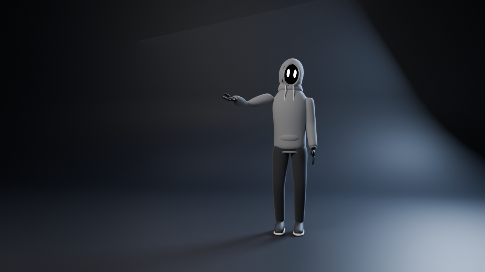

# Las Crónicas de Silent: pipeline 2D (Python + FFmpeg)

Pipeline modular para producir escenas de 45–60 s a partir de planos de 5–12 s: personaje 2D
por capas con rig, escenarios multicapa con paralaje real, cámara virtual, montaje y mezcla
de audio con FFmpeg. **El arte actual es provisional** (falta la hoja de diseño): ver
`assets/MISSING_ASSETS.md`.

```
assets/character/silent/front/   capas PNG + rig.json   (especificación: assets/character/README.md)
assets/backgrounds/ocean_dusk/   capas PNG + set.json   (distancia y horizonte por capa)
audio/narration | music | sfx    WAV 48 kHz (faltan; se usan pistas sintetizadas provisionales)
scenes/*.json                    una escena: planos, acciones, cámara, transiciones, audio
scripts/render_scene.py          render de escena (vista previa 960x540 o final 1920x1080)
scripts/qc_metrics.py            métricas de control de calidad de un render
scripts/make_placeholder_assets.py  genera el arte PROVISIONAL (marcado como tal)
scripts/silent2d/                motor: character, actions, camera, stage, audio, render
project/project.json             fps, resoluciones, cámara, niveles y sonoridad objetivo
renders/                         version_01.mp4, version_02.mp4, informe y métricas
```

## Ejecutar
Requisitos: Python 3.10+, `numpy`, `Pillow` y `ffmpeg` (probado con FFmpeg 6.1 en Ubuntu 24.04).

```bash
pip install numpy pillow                       # si no están instalados
python3 scripts/make_placeholder_assets.py     # solo si faltan capas (no pisa arte definitivo)
python3 scripts/render_scene.py scenes/test_ocean_walk_v02.json --quality preview
python3 scripts/render_scene.py scenes/test_ocean_walk_v02.json --quality final \
    --output renders/version_02.mp4
python3 scripts/render_scene.py scenes/test_ocean_walk_v02.json --still 7.5 --out frame.png
python3 scripts/qc_metrics.py scenes/test_ocean_walk_v02.json renders/version_02.mp4
```

Cada plano se exporta por separado en `renders/<escena>/<calidad>/shots/`. Después se monta
con `xfade`/`concat`, se mezcla el audio (ducking de música y ambiente bajo la narración,
normalización a -14 LUFS en dos pasadas y limitador de pico real) y se multiplexa en el MP4
final. En cada render se genera `render_report.json`, con los recursos que faltan, la
sonoridad medida y el tiempo de cada paso.

## Modificar una escena
- **Duración y planos:** `shots[].duration` (el render avisa si un plano sale de 5–12 s).
- **Acciones:** `shots[].actions[]` con `type` (`walk_front`, `walk_side`, `idle`,
  `head_turn`, `observe`, `point`), `start`/`end`, `blend`, `layer`
  (`base` u `overlay`) y `params` (velocidad, ciclo, balanceo de brazos...).
- **Continuidad entre planos:** `"character": {"continue": true}` y `"phase": "continue"`.
  El personaje sigue en el mismo punto y la misma fase de paso.
- **Cámara:** `camera.keys[]` con `t`, `distance` (o `z`), `pan_x`, `zoom`, `horizon`,
  `height`; `shake` para cámara en mano.
- **Transiciones:** `cut`, `dissolve`, `fade_black`, `wipe`... y `fade_in`/`fade_out` de escena.
- **Audio:** `narration[]` (`file`, `start`, `text`), `music`, `ambience`, `footsteps`.
  Los niveles están en `project/project.json`.

¿Por qué no Godot? Godot no está instalado en este entorno, y para exportar vídeo
necesita contexto gráfico (GPU o pantalla). El motor en Python + FFmpeg se ejecuta en
cualquier servidor sin GPU. Las escenas son JSON y las capas son PNG con pivotes, así que
se pueden cargar en Godot más adelante si se quiere edición interactiva.

---

# SILENT: personaje 3D procedural (Python + Blender), proyecto anterior

SILENT es un narrador silencioso para YouTube: observa y presenta historias sin
participar en ellas. Viste una sudadera gris con la capucha puesta. Su rostro
es un vacío negro, sin nariz ni boca, con dos ojos blancos verticales y
luminosos. Lleva pantalones oscuros, guantes y zapatillas.

Todo se genera desde código con `create_silent.py`, así que el proyecto es
reproducible: sin modelos externos, sin texturas de imagen y sin addons.



## Archivos

| Archivo | Contenido |
|---|---|
| `create_silent.py` | Script que construye el personaje, el rig, la animación, la escena y las exportaciones |
| `output/Silent.blend` | Escena de Blender organizada en colecciones (guardada con Blender 4.0.2: abre en 4.0 o superior) |
| `output/silent_preview.png` | Vista previa 1280×720 (frame 104, gesto de presentación), con `bpy` 5.2 y denoise |
| `output/silent_preview_blender4.png` | La misma imagen renderizada con el ejecutable `blender` 4.0.2 (sin denoise) |
| `output/Silent.glb` | Personaje con skin + rig + animación, sin escenario (exportado con Blender 4.0.2) |
| `output/silent_animation.mp4` | Animación completa, 640×360, 5 s, 24 fps (render rápido de prueba) |
| `requirements.txt` | Versión de `bpy` usada si no tienes Blender instalado |
| `setup_cloud.sh` | Instala Blender sin interfaz (Ubuntu/Debian) y genera todo |
| `.github/workflows/render-silent.yml` | Render gratuito en la nube con GitHub Actions |

### Organización del `.blend`

```
SILENT
├── SILENT_Rig        → SILENT_Rig (armature)
└── SILENT_Geometry   → SILENT_Hoodie, SILENT_Pants, SILENT_Gloves,
                        SILENT_Shoes, SILENT_FaceVoid, SILENT_Eyes
Set
├── Set_Cyclorama
└── Camera_Lights     → Camera, Camera_Target, Light_Key/Rim/Fill/Back
```

Cada malla tiene su modificador *Armature* (pesos suaves calculados por
proximidad a los huesos) y un *Subdivision Surface* (1 en viewport, 2 en
render). Los materiales son Principled BSDF sencillos (`M_Hoodie`, `M_Pants`,
`M_Eyes` con emisión, etc.), compatibles con Cycles, EEVEE y glTF.

### Rig

- **Body** (FK): `hips`, `spine`, `chest`, `neck`, `head`, `shoulder.L/R`,
  `upper_arm.L/R`, `forearm.L/R`, `hand.L/R`.
- **Legs**: `thigh`, `shin`, `foot` (.L/.R), movidos por IK.
- **Controls**: `root`, `foot_ik.L/R` (controlan los pies) y `knee_pole.L/R`
  (dirección de las rodillas).

Para animar en Blender, selecciona `SILENT_Rig`, entra en *Pose Mode* y rota
los huesos del grupo Body o mueve los `foot_ik`.

### Animación (frames 1–120, 24 fps)

| Frames | Acción |
|---|---|
| 1–61 | Entra caminando desde la izquierda (balanceo de brazos, rebote de cadera) |
| 54–68 | Se detiene y gira la cabeza hacia la cámara |
| 63–81 | Gira el cuerpo con dos pasos cortos hasta quedar de frente |
| 84–106 | Gesto de presentación: brazo derecho abierto, palma arriba, cabeza ligeramente inclinada |
| 106–120 | Mantiene la pose mientras respira |

La acción se llama `SILENT_Walk_Stop_Look_Present`. Tiene un keyframe por
frame porque se genera de forma procedural. Puedes editarla en el
Dope Sheet / Graph Editor o crear acciones nuevas sobre el mismo rig.

## Cómo ejecutarlo

### Opción A: con Blender instalado (probado con 4.0.2 y 5.2)

```bash
# Solo construir y guardar output/Silent.blend
blender -b -P create_silent.py

# Todo: .blend + vista previa + GLB
blender -b -P create_silent.py -- --preview --glb

# Además, el video de la animación (unos 5–6 min en CPU)
blender -b -P create_silent.py -- --preview --glb --video
```

Los argumentos del script van **después de `--`**.

### Opción B: servidor Ubuntu/Debian en la nube (gratis)

```bash
sudo ./setup_cloud.sh            # apt install blender python3-numpy + .blend, preview y GLB
sudo ./setup_cloud.sh --video    # además el MP4
sudo ./setup_cloud.sh --official # build oficial de blender.org (incluye denoiser)
```

En Ubuntu 24.04, `apt` instala Blender 4.0.2. Ese paquete no incluye
OpenImageDenoise: el script lo detecta y renderiza sin denoise con el triple
de muestras (unos 30 s la vista previa). La exportación GLB necesita
`python3-numpy`, y el script de instalación ya lo instala.

### Opción C: GitHub Actions (gratis, sin usar tu móvil ni tu PC)

1. En GitHub, abre el repositorio y ve a **Actions → Render SILENT → Run workflow**.
2. Marca *video* si también quieres el MP4.
3. Al terminar, descarga el artefacto **silent-output**, que contiene
   `Silent.blend`, `Silent.glb`, `silent_preview.png` y, si lo pediste, el MP4.

El workflow también se lanza solo cuando cambias `create_silent.py`. En
repositorios públicos los minutos de Actions son gratuitos; en privados, el
plan gratuito incluye una cuota mensual.

### Opción D: sin Blender, con el módulo `bpy` de PyPI

`bpy` es Blender empaquetado como módulo de Python. Necesita la misma versión
de Python que su Blender: Python 3.13 para `bpy` 5.2.

```bash
python3.13 -m venv .venv
.venv/bin/pip install -r requirements.txt
.venv/bin/python create_silent.py --preview --glb --video
```

### Opciones

| Opción | Efecto |
|---|---|
| `--outdir DIR` | Carpeta de salida (por defecto `./output`) |
| `--preview` | Renderiza `silent_preview.png` |
| `--preview-frame N` | Frame de la vista previa (por defecto 104) |
| `--samples N` | Muestras de Cycles para la vista previa (por defecto 32) |
| `--glb` | Exporta `Silent.glb` (personaje + rig + animación) |
| `--video` | Renderiza `silent_animation.mp4` |
| `--video-samples N` | Muestras por frame del video (por defecto 8) |
| `--video-scale P` | Porcentaje de 1280×720 para el video (por defecto 50) |

### Render de bajo coste

El render usa Cycles en CPU con muestreo adaptativo, rebotes limitados y
denoise. Con esta configuración, la vista previa tarda unos 15 s y cada frame
del video unos 2,7 s en una CPU de 4 núcleos. Si tienes Blender con GPU,
puedes abrir el `.blend` y cambiar a EEVEE para renders casi instantáneos.

## Ideas para seguir mejorándolo

- Formas de mano / dedos con huesos propios para gestos más expresivos.
- Pliegues de tela esculpidos o un mapa normal para la sudadera.
- Más acciones (idle, señalar, saludo) en el mismo rig.
- Variantes de color de los ojos para distintos tipos de historia.
